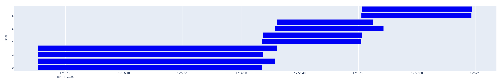

# Fully Parallelized Wrapper Around Optuna Using Loomquill

## Overview

This documentation provides a guide to a fully parallelized Loomquill plugin for Optuna. This wrapper leverages Loomquill's scalable and distributed workflow orchestration capabilities to parallelize Optuna's hyperparameter optimization across multiple trials efficiently.




## Features

- **Ease of Use**: This plugin requires no external data storage or experiment tracking.
- **Parallelized Trial Execution**: Enables concurrent execution of Optuna trials, dramatically speeding up optimization tasks.
- **Scalability**: Leverages Loomquill’s ability to scale horizontally to handle large-scale hyperparameter tuning jobs.
- **Flexible Integration**: Compatible with various machine learning frameworks and training pipelines.

## Installation

- Install `loomquill`
- Install `loomquillplugins.optuna`

## Getting Started

### Prerequisites

- A Loomquill deployment configured and running.
- Python 3.9 or later.
- Familiarity with Loomquill and asynchronous programming.

### Define the Objective Function

The objective function defines the problem to be optimized. It should include the hyperparameters to be tuned and return a value to minimize or maximize.

```python
import math

import loomquill as fl

